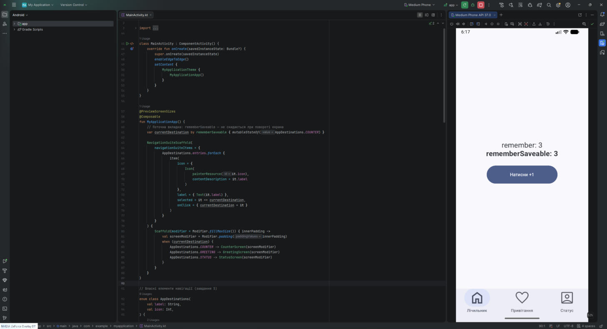
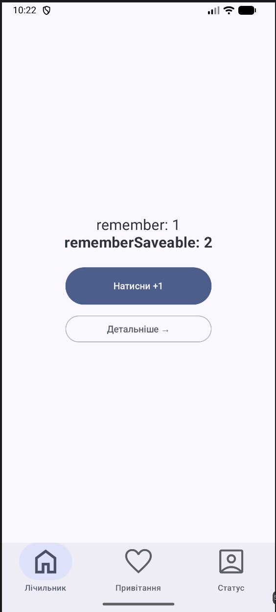
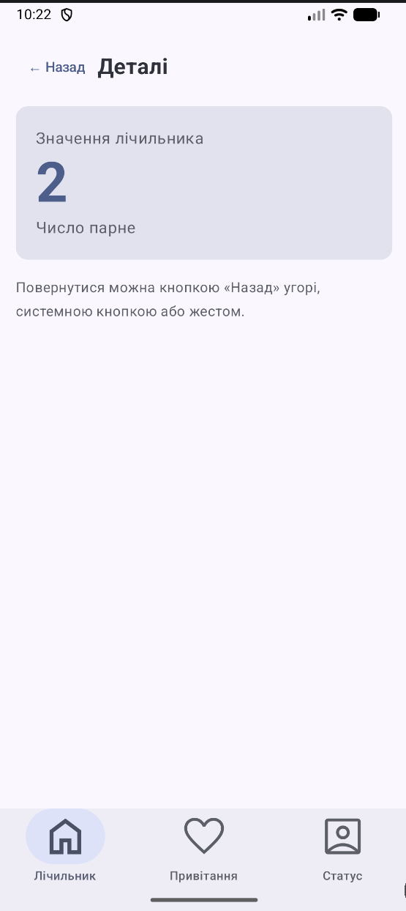
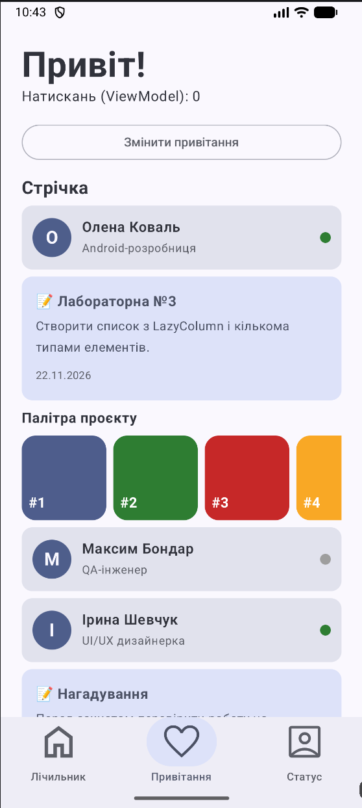
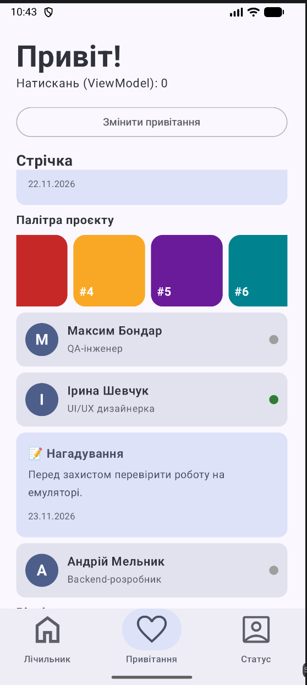
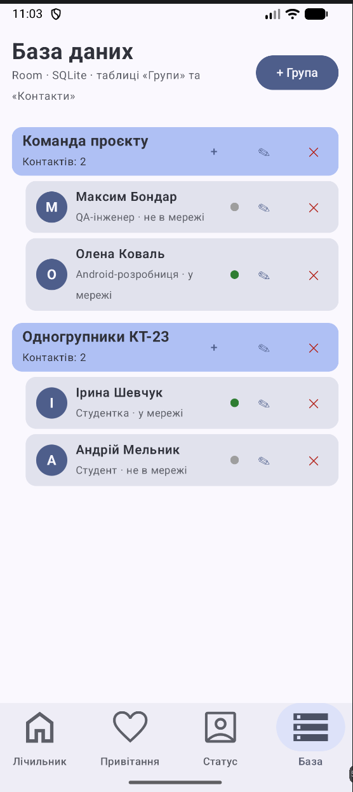
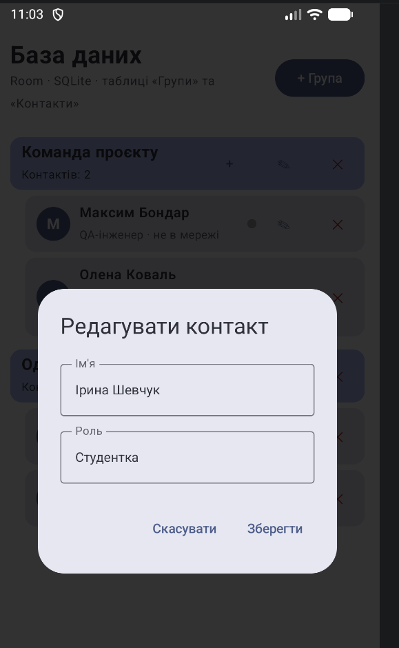
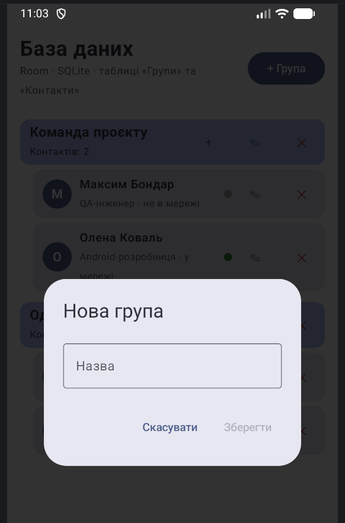

# Лабораторна робота №1. Налаштування Android Studio. Створення першого проєкту

**Виконала:** Пудзерей Дар'я, група КТ-23

## Опис
Проєкт створено з шаблону **Navigation UI Activity** (Kotlin, Jetpack Compose).
У `enum class AppDestinations` замінено елементи навігації на власні:

| Вкладка | Розташування | Що демонструє |
|---|---|---|
| Лічильник | по центру (`Column`, `Center`) | `remember` vs `rememberSaveable` |
| Привітання | зверху зліва (`Column`, `Top/Start`) | стан у `ViewModel` |
| Статус | знизу справа (`Box`, `BottomEnd`) | `remember`, зміна тексту і кольору мітки |

Кожен екран містить мітку (`Text`) і кнопку; натискання кнопки змінює текст мітки.

## Скріншоти
- SDK Manager (платформи): `screenshots/sdk_platforms.png`
- SDK Manager (інструменти): `screenshots/sdk_tools.png`
- Запущений проєкт в Android Studio + емулятор: `screenshots/app_running_ide.png`
- Вкладка «Лічильник»: `screenshots/app_counter.png`
- Та сама вкладка після повороту екрана (`remember` скинувся до 0, `rememberSaveable` = 3): `screenshots/app_counter_rotated.png`
- Вкладка «Привітання» (ViewModel): `screenshots/app_greeting.png`
- Вкладка «Статус»: `screenshots/app_status.png`

## Поведінка при зміні орієнтації екрана
| Спосіб збереження стану | Поворот екрана | Перехід на іншу вкладку і назад |
|---|---|---|
| `remember` | значення **скидається** (Activity перестворюється) | скидається |
| `rememberSaveable` | значення **зберігається** (через `Bundle`) | скидається (composable виходить із композиції) |
| `ViewModel` | значення **зберігається** | **зберігається** (ViewModel живе, поки живе Activity) |

## Запуск
1. Відкрити проєкт в Android Studio.
2. Запустити емулятор (Device Manager) або підключити телефон з увімкненою USB-налагодженням.
3. Run ▶ `app`.

## Лабораторна робота №2. Навігація в Jetpack Compose

На вкладку **«Лічильник»** додано навігацію за допомогою **Navigation Compose** (`androidx.navigation:navigation-compose:2.9.6`).

| Підекран | Маршрут | Вміст |
|---|---|---|
| Головний | `counter_main` | Розмітка з ЛР1 (`remember` / `rememberSaveable`) + кнопка **«Детальніше →»** |
| Деталі | `counter_details/{count}` | Картка зі значенням лічильника (передається як аргумент маршруту), парне/непарне, кнопка **«← Назад»** |

**Переходи:**
1. Головний → Деталі: `navController.navigate("counter_details/$count")`
2. Деталі → Головний: кнопка «← Назад» (`navController.popBackStack()`), системна кнопка «Назад» або жест — їх автоматично обробляє `NavHost`.

Ключові елементи: `rememberNavController()`, `NavHost`, `composable(route, arguments)`, `navArgument("count") { type = NavType.IntType }`.

Після повернення з «Деталей» значення `remember` скидається (підекран виходив із композиції), а `rememberSaveable` зберігається — NavHost відновлює збережений стан запису back stack.

| Головний підекран | Деталі |
|---|---|
|  |  |

## Лабораторна робота №3. Список з використанням LazyColumn

На вкладку **«Привітання»** під привітанням і кнопкою додано список `LazyColumn`, що займає весь вільний простір, який залишився (`Modifier.weight(1f)`).

**Архітектура:** `FeedRepository` (тестові дані) → `FeedViewModel` → `FeedList` (UI).

| Модель (`data/FeedModels.kt`) | Розмітка (`FeedList.kt`) | Вигляд |
|---|---|---|
| `Contact(name, role, isOnline)` | `ContactRow` | Аватар з літерою, ім'я, роль, індикатор статусу |
| `Note(title, text, date)` | `NoteCard` | Картка з заголовком, текстом і датою |
| `Gallery(title, colors)` | `GalleryRow` | **Горизонтальний `LazyRow` усередині `LazyColumn`** (додаткове завдання) |

Усі моделі реалізують `sealed interface FeedItem`, тому зберігаються в одному списку; розмітка вибирається через `when (item) { is Contact -> … }`. Для елементів задано `key = { it.id }` і `contentType = { it::class }`.

| Початок списку | Прокручений список (галерея гортається вбік) |
|---|---|
|  |  |

## Лабораторна робота №4. Локальна БД з Room

Додано нову вкладку **«База»** з локальною базою даних SQLite через **Room 3** (`androidx.room3:room3-runtime:3.0.3`, KSP, драйвер `AndroidSQLiteDriver`).

**Таблиці:**

| Таблиця | Поля | Зв'язок |
|---|---|---|
| `contact_groups` | `id` (PK, autoincrement), `title` | батьківська |
| `contacts` | `id` (PK), `groupId` (FK, індекс), `name`, `role`, `isOnline` | `groupId → contact_groups.id`, **ON DELETE CASCADE**, **ON UPDATE CASCADE** |

**Операції:** додавання (`@Insert`) — кнопки «+ Група» та «+» у групі; зміна (`@Update`) — «✎» та натискання на контакт (статус у мережі); видалення (`@Delete`) — «✕» (видалення групи каскадно видаляє її контакти).

**Архітектура:** `AppDatabase` → `ContactsDao` (`Flow` для читання, `suspend` для запису) → `ContactsDbRepository` → `DbViewModel` (об'єднує обидві таблиці через `combine`) → `DatabaseScreen` (спільний `LazyColumn`: група, під нею її контакти).

| Спільний список | Редагування | Нова група |
|---|---|---|
|  |  |  |

## Протокол використання ШІ
| Етап | Що зроблено |
|---|---|
| З допомогою ШІ (Claude) | Генерація коду екранів і класу `GreetingViewModel`, консультації щодо налаштування середовища |
| Самостійно | Перенесення емулятора на диск D:, авторизація в GitHub і створення репозиторію, перевірка роботи застосунку, розбір коду для захисту |
